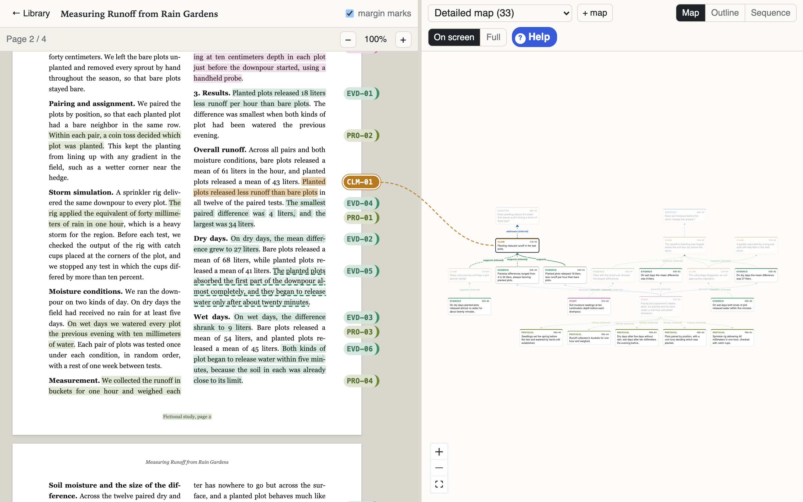

# PDF/MIRA graph viewer

Read a research PDF beside a generated map of its questions, claims, and evidence. Scroll the paper to see the relevant part of the argument, or select a card to find its passage in the PDF. The reader keeps the authors’ words distinct from the AI-generated interpretation and marks estimated locations and inferred links.



The bundled fictional Rain Gardens paper, shown in the reader.

## Default local dev

"Use default local dev" means this setup. Run it exactly as written and change nothing else:

```sh
pnpm install --frozen-lockfile && pnpm dev
```

- **What you get:** the reader at [localhost:5178](http://localhost:5178/), with the bundled fictional sample paper and its two maps. The sample's PDF and maps are local files.
- **Needs nothing else:** no sign-in, no API key, and no network after install.
- **Leave alone:** the invite gate (it only runs under `pnpm preview` and is not part of this setup), the OpenRouter key, and arXiv imports. Do not use **Add paper**.
- **Checks:** `pnpm typecheck`, `pnpm test`, and `pnpm build` work in this setup too.
- **Fully isolated alternative:** `pnpm dev:mock` serves the same sample on `http://127.0.0.1:5188/` with fixed mock AI results. Use it only if asked.

## Run locally

Requirements: Node.js 24, pnpm 11, and Git. The browser checks and screenshot script also need Chrome or Chromium.

```sh
pnpm install --frozen-lockfile
pnpm dev
```

Open [localhost:5178](http://localhost:5178/) and choose an example from the Library. The examples work without an API key.

To import a new arXiv paper, set `OPENROUTER_API_KEY` in the server environment before starting the app, then use **Add paper**. Generation sends the paper’s Markdown to OpenRouter and may incur charges. Keep the key out of Git, command arguments, and logs. Imported PDFs open directly from arXiv. The server keeps the text in a private cache for retries. Papers and maps you add are stored under `data/papers`, which Git ignores.

Run this prototype on your own computer or a trusted private network. The development server listens on localhost, and the API has no accounts. An optional invite gate for shared deployments is described in the [development guide](docs/development.md#optional-invite-gate).

## Check your changes

```sh
pnpm typecheck
pnpm test
pnpm build
```

`pnpm dev:mock` runs a separate reader with bundled PDFs and fixed mock AI results, and needs no credentials. `pnpm verify:mock` checks it in headless Chrome. Set `CHROME` to the browser executable if it is not at the macOS default. See [local mock development](docs/mock-development.md). The [development guide](docs/development.md) lists every script and environment variable.

## Where things are

- `src/`: the browser reader (React, pdf.js, React Flow).
- `server/`: the paper API and optional invite gate, mounted into Vite’s dev and preview servers. There is no separate backend process.
- `samples/`: a fictional example paper and maps that seed an empty library.
- `public/help.html`, `public/help/img/`: the full user help and its images.
- `scripts/`: verification, screenshot, and maintenance scripts.
- `test/`: vitest tests.
- `data/` and `output/`: local working folders. Git ignores them, and nothing in the project depends on their contents.

This repository holds the whole project. It has no private deployment settings, credentials, or hosts. Do not add any. Keep hostnames, invite files, signing keys, and API keys outside the repository.

- [User help](public/help.html), also available under **Help** in the app
- [Development guide](docs/development.md): API, storage, configuration, and reader internals
- [Contributing](docs/development.md#contributing): conventions, and the rule to update the help with every visible change
- [Sample](samples/README.md)
- [Ideas](docs/ideas.md)

Set `PDF_MIRA_CONTACT_EMAIL` in the server environment to enable **Feedback** and, on deployments with the invite gate, **Request access**.

## License

The project and its bundled fictional sample are available under the [MIT License](LICENSE). The project holds no third-party papers; papers you import stay in your local library.

The map generator depends on [MIRA-extraction](https://github.com/MIRA-science/MIRA-extraction), which has not published a license. It is installed from its repository and is not part of this project's code or license. Check with its authors before redistributing a package or image that bundles it.
